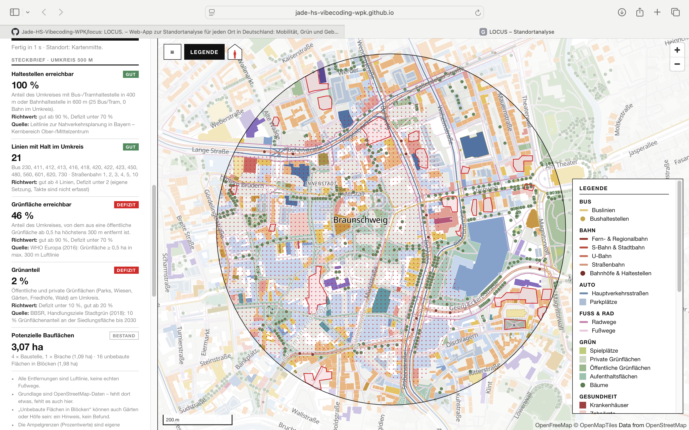

# LOCUS. – Standortanalyse für jeden Ort in Deutschland

**LOCUS** zeigt für jeden Ort in Deutschland, wie er angebunden ist, wo es grün ist und wie die Gebäude genutzt werden – Layer für Layer, im Maßstab. Und macht sichtbar, wo es Defizite gibt.

- **App:** https://jade-hs-vibecoding-wpk.github.io/locus/
- **Demo mit Anleitung:** https://jade-hs-vibecoding-wpk.github.io/locus/demo.html – Braunschweig, Burgplatz, Schritt für Schritt zum Ausprobieren

Ein Projekt von **Bethje Blesse** und **Anastasia Müller** · Studienprojekt Architektur · WPK Vibecoding · Jade Hochschule Wilhelmshaven/Oldenburg/Elsfleth · 2026

---

## Was LOCUS kann

| Bereich | Inhalt |
|---|---|
| **01 Mobilität** | Buslinien und -haltestellen, Fern-/Regionalbahn, S-Bahn & Stadtbahn, U-Bahn, Straßenbahn, Bahnhöfe, Hauptverkehrsstraßen, Parkplätze, Rad- und Fußwege |
| **02 Grün** | Spielplätze, private und öffentliche Grünflächen, Aufenthaltsflächen (inkl. Bänke), Bäume |
| **03 Nutzungen** | Gebäude eingefärbt nach Nutzung: Gesundheit, Einkaufen, Freizeit, Bildung, Wohnen |
| **04 Defizitanalyse** | Umkreis 300 / 500 / 800 m: Haltestellen und Grünflächen in Reichweite, Grünanteil, Linien, potenzielle Bauflächen – mit Steckbrief und Ampeln |

Weitere Funktionen:

- Ortssuche oder rote **Standort-Figur** aus dem Haus auf die Karte ziehen
- feste Maßstäbe 1 : 500 bis 1 : 5.000
- **PDF-Export im Maßstab** (A4–A1, hoch/quer) mit Legende, Nordzeichen und Plankopf
- eigenes **PDF-Blatt „Defizitanalyse“** mit Umkreiskarte, Legende und Steckbrief
- Info-Fenster beim Anklicken (Name, Adresse, Öffnungszeiten, Linien an Haltestellen, Link zu OpenStreetMap)
- Kartenbeschriftung auf Deutsch

## Installation

**Keine Installation nötig.** LOCUS ist eine einzige HTML-Datei und läuft in jedem aktuellen Browser (getestet: Safari auf dem Mac, Firefox unter Windows).

- **Online:** https://jade-hs-vibecoding-wpk.github.io/locus/ öffnen – fertig.
- **Lokal:** `index.html` herunterladen und per Doppelklick im Browser öffnen. Eine Internetverbindung ist trotzdem nötig, weil Karte, Daten und Bibliotheken live geladen werden.
- **Eigene Kopie im Netz:** Repository forken, `index.html` behalten und unter *Settings → Pages* „Deploy from a branch“ → `main` / `(root)` einschalten.

Es werden **keine API-Keys** und keine Anmeldung gebraucht; alle genutzten Dienste sind frei zugänglich.

## So benutzt ihr LOCUS

1. Website öffnen, auf **„Los geht’s →“** klicken.
2. Ort suchen oder die Figur aus dem Haus auf die Karte ziehen.
3. Maßstab wählen (zum Laden 1 : 5.000 oder näher).
4. Unter **Layer** die gewünschten Gruppen einschalten, dann **„Daten für diesen Ausschnitt laden“**.
5. Optional: **Defizitanalyse** – Umkreis wählen, „Analysieren“.
6. **PDF-Export:** Format, Ausrichtung, Maßstab und Titel wählen, Rahmen auf der Karte zurechtschieben, „PDF erstellen“.

Ein Internetzugang ist nötig. Es wird nichts installiert und keine Anmeldung gebraucht.

## Defizitanalyse – Richtwerte und Quellen

| Thema | Richtwert | Quelle |
|---|---|---|
| Haltestellen erreichbar | Bus/Tram ≤ 400 m, Bahn ≤ 600 m Luftlinie | Leitlinie zur Nahverkehrsplanung in Bayern (Kernbereich Ober-/Mittelzentrum) |
| Grünfläche erreichbar | öffentliche Grünfläche ≥ 0,5 ha in max. 300 m Luftlinie | WHO Europa (2016) |
| Grünanteil | mind. 10 % Grünfläche | BBSR, Handlungsziele Stadtgrün (2018) |
| Linien | gut ab 4 Linien mit Halt im Umkreis | eigene Setzung |

Die Prozentgrenzen der Ampeln (gut / mittel / Defizit) sind eigene Setzungen auf Basis dieser Richtwerte.

## Grenzen

- Alle Entfernungen sind **Luftlinie**, keine echten Fußwege.
- Grundlage sind **OpenStreetMap-Daten** – fehlt dort etwas, fehlt es auch in LOCUS. Auf dem Land ist oft weniger erfasst als in der Stadt.
- „Unbebaute Flächen in Blöcken“ können auch Gärten oder Höfe sein – ein Hinweis, kein Befund.
- Gebäude ohne bekannte Nutzung in Wohngebieten werden als „Wohnen (vermutet)“ gezeigt.
- Takte und Fahrpläne sind nicht erfasst.
- Der Maßstab auf dem Bildschirm ist nur ungefähr (96 dpi); exakt ist er im PDF.

## Dateien

| Datei | Inhalt |
|---|---|
| `index.html` | die App (eine einzige Datei, läuft im Browser) |
| `demo.html` | Demo mit Anleitung und fest eingebauten Daten für Braunschweig, Burgplatz |
| `README.md` | diese Beschreibung |
| `screenshot.png` | Bildschirmfoto für README und Projekt-Straße |
| `LICENSE` | Lizenz des Codes (Apache 2.0) |
| weitere Dateien | Zwischenstände der Entwicklung (siehe unten) |

## Entwicklungsverlauf

Die fertige App ist **`index.html`**, die Demo **`demo.html`**. Die übrigen Dateien im Repository sind ältere Zwischenstände. Sie bleiben bewusst erhalten, damit der Arbeitsprozess nachvollziehbar ist:

| Datei | Inhalt |
|---|---|
| `standortanalyse.html` | erster lauffähiger Stand (16.11.2026): Karte, Suche, Maßstab, erste Layer |
| `standortanalyse_zwischenstand_….html` | Zwischenstand (17.11.2026): alle drei Layer-Gruppen, Info beim Anklicken, PDF-Export im Aufbau |
| `LOCUS_stand_2026-11-18.html` | Stand 18.11.2026: Name LOCUS, Swiss Style, Startseite mit Globus, schnelleres Laden, PDF im Maßstab |
| `LOCUS_demo.html` | erste Demo-Version mit Anleitung (Köln, Belgisches Viertel) – ersetzt durch `demo.html` (Braunschweig) |
| `Konzeptblatt_Standortanalyse_App.md` | Konzeptblatt mit Entscheidungen, Farbkonzept, Testergebnissen und Fahrplan |

Jeder Upload ist außerdem im Versionsverlauf von GitHub gespeichert (Uhr-Symbol „History“ über der Dateiliste).

## KI-Nutzung

LOCUS wurde mit **Claude** (Anthropic, Modell Claude Opus 5.5) im Chat entwickelt. Die Aufteilung:

- **Team:** Idee und Konzept, Auswahl der Themen und Layer, Farbkonzept, Gestaltung (Swiss Style, Startseite, Plankopf, Standort-Figur), alle inhaltlichen Entscheidungen (z. B. Richtwerte, Bezeichnungen, Demo-Ort), Testen im eigenen Browser und Rückmeldung nach jedem Schritt, Einrichtung von GitHub Pages.
- **Claude:** den gesamten Programmcode geschrieben, Varianten vorgeschlagen und nach Rückmeldung überarbeitet, Lade- und Funktionstests in einem Testbrowser durchgeführt, Richtwerte, Lizenzen und Dienste recherchiert (mit Quellenangabe), README- und Beschreibungstexte entworfen, QR-Codes erzeugt.

Gearbeitet wurde schrittweise: erst Fragen klären, dann planen und testen, dann einbauen – nach jedem Schritt eine Pause für Test und Feedback. Alle Ergebnisse wurden vom Team im Browser geprüft. Die Richtwerte der Defizitanalyse stammen aus den oben genannten Quellen; die Ampelgrenzen sind eigene Setzungen.

---

## Verwendete Bibliotheken

Alle Bibliotheken werden beim Öffnen von einem öffentlichen CDN geladen (jsDelivr, unpkg oder cdnjs als Ersatz).

| Bibliothek | Version | Wofür | Lizenz |
|---|---|---|---|
| [MapLibre GL JS](https://maplibre.org/) | 4.7.1 | interaktive Karte, Kartenbild für das PDF | BSD-3-Clause |
| [jsPDF](https://github.com/parallax/jsPDF) | 2.5.1 | PDF-Erzeugung im Browser (wird erst beim ersten Export geladen) | MIT |
| [D3](https://d3js.org/) | 7 (7.9.0) | Globus auf der Startseite (Projektion und Zeichnen) | ISC |
| [world-atlas](https://github.com/topojson/world-atlas) | 2 (2.0.2), Datei `countries-110m.json` | Ländergrenzen für den Globus | ISC; Daten: Natural Earth (gemeinfrei) |
| [Niedersachsen-Cache](https://jade-hs-vibecoding-wpk.github.io/niedersachsen-cache/) (`nds-cache.js`, Jade Hochschule) | 1.1.0 | vorbereitete OSM-Daten für niedersächsische Städte (schnelleres Laden) | keine Lizenzangabe gefunden – bitte bei der Jade Hochschule erfragen |

Eigener Code (ohne Bibliothek): Laden und Auswerten der Daten, Defizitanalyse, Legende, PDF-Layout, Startseite.
Schrift: Helvetica Neue / Helvetica / Arial des eigenen Systems (keine Web-Schrift).

## Verwendete Dienste und Daten

| Dienst | Wofür | Lizenz / Bedingungen |
|---|---|---|
| [OpenStreetMap](https://www.openstreetmap.org/copyright) | alle Kartendaten | Open Database License (ODbL) – © OpenStreetMap-Mitwirkende |
| [Overpass API](https://wiki.openstreetmap.org/wiki/Overpass_API) – Server overpass-api.de, maps.mail.ru, overpass.private.coffee, overpass.kumi.systems | Abfrage der OSM-Daten | Software: GNU AGPL v3; Nutzung nach den Regeln der jeweiligen Server |
| [OpenFreeMap](https://openfreemap.org/) – Stil „Positron“ | Grundkarte | Projekt: MIT; Kartenschema OpenMapTiles (Code BSD-3-Clause, Design CC BY 4.0); Daten © OpenStreetMap |
| Esri „World Light Gray Base“ | Ersatz-Grundkarte, falls OpenFreeMap nicht erreichbar ist | Esri-Nutzungsbedingungen; Quellen: Esri, HERE, Garmin, © OpenStreetMap-Mitwirkende |
| [Nominatim](https://nominatim.org/) (nominatim.openstreetmap.org) | Ortssuche | Nutzungsrichtlinie der OSMF (höchstens 1 Anfrage pro Sekunde); Daten ODbL |
| [Photon](https://photon.komoot.io/) (komoot) | Ersatz für die Ortssuche | Software: Apache 2.0; faire Nutzung; Daten ODbL |

**Quellenangabe auf Karte und PDF:**
Kartendaten © OpenStreetMap-Mitwirkende (ODbL) · Grundkarte: OpenFreeMap, © OpenMapTiles

---

© 2026 Bethje Blesse und Anastasia Müller · Studienprojekt an der Jade Hochschule. Der Code steht unter der **Apache License 2.0** (siehe `LICENSE`). Kartendaten © OpenStreetMap-Mitwirkende (ODbL).
